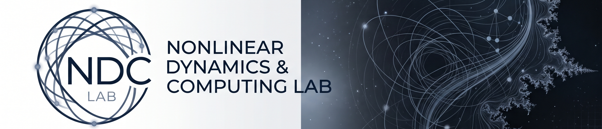

  
  
    

  # Nonlinear Dynamics & Computing Lab (NDC Lab)
  *Deciphering Chaos through High-Performance Computation and Complex Networks.*

---

## 🔬 About the Lab
O **NDC Lab** atua na fronteira da física teórica, da modelagem de sistemas dinâmicos e da Ciência de Dados. O nosso foco principal é a transição contínua-discreta de sistemas caóticos, utilizando simulações massivamente paralelas e a teoria de grafos para revelar estruturas topológicas ocultas no espaço de fases.

Investigamos fenômenos complexos que vão desde a mecânica relativística até à dinâmica de osciladores não-lineares, transformando rigor matemático em algoritmos computacionais de alto desempenho.

---

## 👨‍🔬 Principal Investigator
**Mauricio Ap. Ribeiro** lidera as pesquisas do laboratório. Com uma base analítica multidisciplinar que engloba graduação em Matemática, mestrado em Química Aplicada e doutorado em Física Teórica — complementada por estágios pós-doutorais em Física e Engenharia Elétrica, além de formação avançada em Ciência de Dados —, o seu trabalho une a abstração teórica ao processamento massivo de dados. 

A sua linha de investigação prioriza exclusivamente o avanço da modelagem de sistemas físicos complexos, traduzindo dinâmicas de equações diferenciais para a topologia de redes e análise de dados, operando na interseção perfeita entre a academia de ponta e a computação avançada.

---

## 🌌 Core Research Areas

### 1. Relativistic Dynamics & Topological Chaos
Estudo aprofundado do problema de múltiplos corpos sob correções de Einstein-Infeld-Hoffmann (1PN e 2.5PN). A pesquisa mapeia fronteiras fractais e bacias de Wada, quantificando o caos transitório e o decaimento orbital gerado pela emissão de ondas gravitacionais.

### 2. Phase Space as Complex Networks
Aplicação inovadora da teoria de grafos à dinâmica não-linear. O laboratório converte a dinâmica do espaço de fases tridimensional em Redes de Transição de Estado, utilizando métricas de centralidade e topologia discreta para caracterizar a imprevisibilidade estrutural do sistema.

### 3. Piezoelectric Energy Harvesting & Hysteresis
Modelagem computacional de transdutores piezoelétricos em pórticos, analisando modelos de histerese (Bouc-Wen) e o controle passivo da dissipação de energia através de dinâmica não-linear rigorosa.

---

## 💻 Computing & Tech Stack
O rigor das nossas simulações exige ferramentas de ponta. O laboratório opera rotineiramente com:
* **Julia (CUDA.jl & DynamicalSystems.jl):** Para integração massivamente paralela em GPU (RK4) e exploração do espaço de parâmetros em alta resolução.
* **Python (SciPy, NetworkX, Pandas):** Para o processamento de Ciência de Dados, extração de métricas topológicas (Expoente de Incerteza, Dimensão Fractal) e geração de painéis de visualização com qualidade de publicação.

---

## 📚 Selected Active Research & Publications
O NDC Lab mantém um compromisso com a excelência, focando em periódicos internacionais de alto impacto. 

* **Active Submissions & Revisions:** 
  * Pesquisas em avaliação rigorosa nas prestigiadas revistas *Communications in Nonlinear Science and Numerical Simulation (CNSNS)* e *Chaos, Solitons & Fractals*.
* **Recent Highlights:** 
  * Análise computacional utilizando redes complexas para extração de topologias em letras de Heavy Metal (aceito, *Advances in Complex Systems*).
  * Dinâmica de energy harvesting piezoelétrico (*MDPI*).

---

  
<b>NDC Lab</b> | Curitiba, PR - Brazil | Contact: <i>[Inserir seu email ou link para o LinkedIn]</i>

